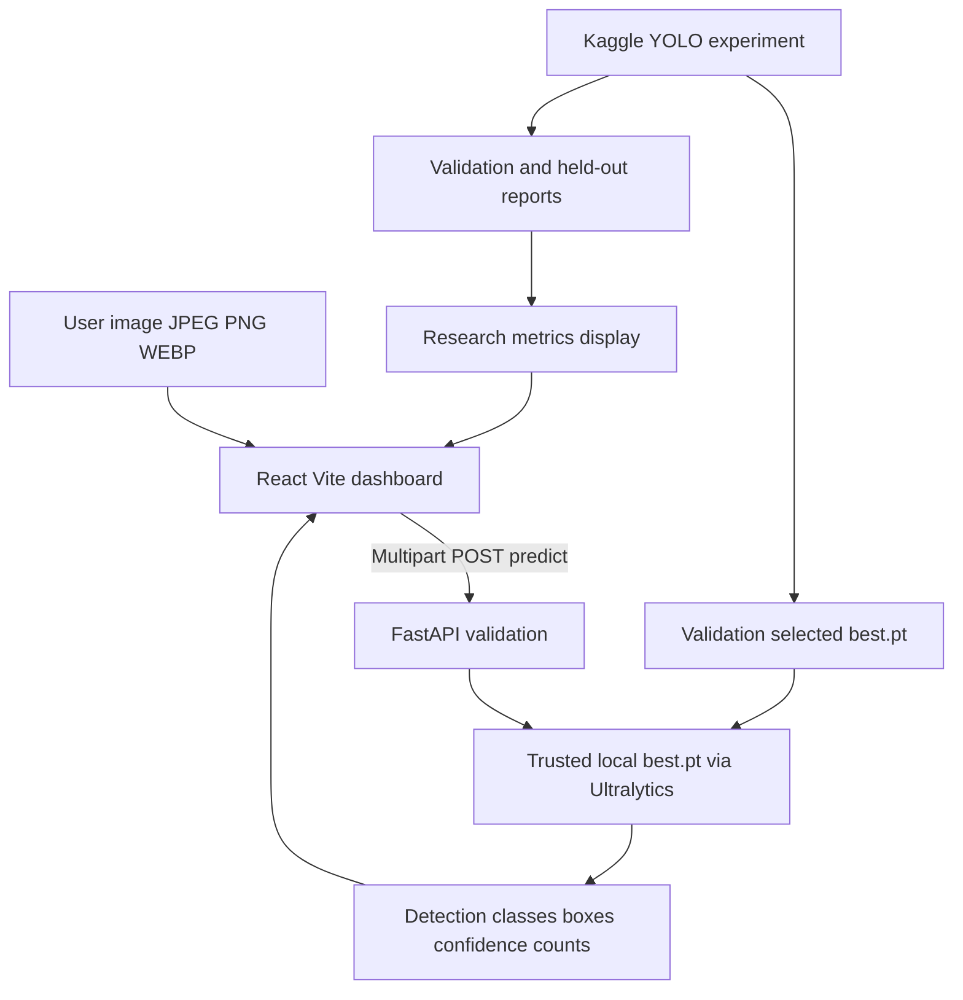

# EggSizeGrader — Day 38 / 100 Days of Projects

**EggSizeGrader** is Day 38 of the [100 Days of Projects](https://github.com/MENSTRUE) portfolio. It detects bounding boxes and annotated classes (`large`, `medium`, `small`) in egg photographs using a validation-selected YOLOv8n checkpoint. The project joins a leakage-aware Kaggle experiment, local FastAPI inference, and a React/TypeScript analysis interface. **It does not measure physical diameter or weight and is not an official commercial grading system.**

> **Scientific scope:** image-annotated detection categories, not physical size measurement or commercial grading.

**Documentation / Dokumentasi:** [English](docs/en/README.md) · [Bahasa Indonesia](docs/id/README.md)

## 1. Professional overview

**EggSizeGrader** is Day 38 of the [100 Days of Projects](https://github.com/MENSTRUE) portfolio. It detects bounding boxes and annotated classes (`large`, `medium`, `small`) in egg photographs using a validation-selected YOLOv8n checkpoint. The project joins a leakage-aware Kaggle experiment, local FastAPI inference, and a React/TypeScript analysis interface. **It does not measure physical diameter or weight and is not an official commercial grading system.**

## 2. Executive summary

The validated model is a YOLOv8n detector trained with a fresh 227/41/50 image split; reported held-out mAP@50–95 is **84.28%**. The repository contains notebook, evaluation artifacts, frontend/backend source and a local demo screenshot; the `.pt` checkpoint is excluded from Git.

## 3. Problem statement

A visual workflow can help count and organize eggs according to **dataset-provided size labels**. Apparent pixel size depends on camera distance, perspective and scene, so this is not a measurement instrument.

## 4. Target users and use cases

Students, researchers and developers can test YOLO detection, evaluate leakage controls, compare per-class AP and inspect local inference. Commercial sorting decisions are out of scope.

## 5. Objectives and research questions

Can a three-class YOLOv8n detector identify the annotated egg objects on held-out grouped samples? How sensitive are the benchmark splits to shared Roboflow source identifiers? Does the real checkpoint serve live local uploads?

## 6. Scope and non-goals

In scope: bounding boxes, class labels, confidence, counts, local inference, leakage-aware evaluation. Out of scope: grams, millimetres, calibration, food safety, regulatory grades, industrial production.

## 7. Before–Now–Next

**Before:** two upstream Roboflow archives were discovered, only the 3-class source chosen. **Now:** Kaggle training/evaluation, FastAPI + React and a 13-object local screenshot exist. **Next:** live ground-truth comparison, robustness/camera-shift experiment, usability and security review.

## 8. Implementation status

**Verified from repository:** source code, 4 API contract tests, metrics JSON, screenshots, image examples. **Reported locally:** 4/4 pytest passed, dependencies installed, screenshot of successful inference. **Not verified:** hosted deployment, cross-device benchmark, repeated production reliability.

## 9. Features and maturity

Implemented: image upload (JPEG/PNG/WEBP, ≤10 MiB), confidence and IoU settings, class-specific boxes, counts, annotated PNG and CSV download, readiness indicator, research-insights panel. Export/live inference require a locally available model. Authentication, audit trails, persistence and multi-user scheduling are not implemented.

## 10. System architecture



## 11. End-to-end workflow

Kaggle source discovery → annotations/duplicates audit → identity-aware resplit → train YOLOv8n → choose `best.pt` from validation → once-only held-out evaluation → move trusted checkpoint locally → POST image → FastAPI validation → YOLO inference → overlay and exports.

## 12. Dataset and provenance

The actually used input is `/kaggle/input/datasets/loliwibu/eggsizegrader-dataset`, YAML naming `large`, `medium`, `small`. Declared upstream: [Roboflow EGGS SIZES FINAL v2](https://universe.roboflow.com/abegaille-jean-lapiz/eggs-sizes-final/dataset/2), workspace `abegaille-jean-lapiz`. The *other* two-class source was not combined. Provenance recorded UTC 2026-11-15.

## 13. Dataset license and attribution

The dataset YAML **declares** `CC BY 4.0`; upstream permission must be checked separately. Attribution to the named Roboflow project is retained. `LICENSE` in this repo expressly says **license not yet selected**, so no blanket permissive source-code license is claimed. Ultralytics, weights, and any third-party dependencies require their own license review for distribution.

## 14. Discovery and data audit

318 image/label pairs were audited; original folders: train 262, valid 38, test 18. YOLO labels were checked for class indices and normalized box coordinates. No backgrounds were recorded. See `reports/source_inventory.csv` and `reports/annotation_issues.csv`.

## 15. Classes and annotation definition

Class index 0=`large`, 1=`medium`, 2=`small`. Each YOLO annotation row holds `class_id cx cy width height`, normalized relative to image dimensions. These names are human-provided image labels, not instrument measurements.

## 16. Cleaning and preprocessing

Corrupt/unreadable images, missing labels, invalid class IDs or out-of-range boxes were designed to trigger a fail-fast stop. Source filename `.rf.*` suffixes were normalized to derive conservative source identities; SHA-256 hashes were also computed. Dataset repackaging copies verified image/label pairs into Kaggle working directories.

## 17. Split and distribution

| Split | Images | Large boxes | Medium boxes | Small boxes |
|---|---:|---:|---:|---:|
| Train | 227 | 524 | 689 | 561 |
| Validation | 41 | 146 | 64 | 101 |
| Held-out test | 50 | 136 | 131 | 112 |
| **Total** | **318** | **806** | **884** | **774** |


## 18. Duplicate and leakage assessment

Original split inspection found **12 source keys crossing original splits** and **0 identical SHA-256 hashes crossing splits**. A union of source-name and byte-hash identities produced **153 conservative groups**. GroupShuffleSplit (seed 42) placed each group entirely within one new split. This does not exclude visually similar images having different filenames/hashes.

## 19. Model architecture

Ultralytics **YOLOv8n** object detector (reported 3,011,433 parameters with detection head adapted from 80 to 3 classes). The saved PyTorch checkpoint is `models/best.pt` locally; `.pt` is Git-ignored. Inference is forced to CPU in `backend/app/inference/yolo.py`.

## 20. Experiment and baseline

One pretrained architecture was trained; there is no cross-architecture controlled comparison. An always-no-boxes sanity baseline yields zero recall on annotated samples, but **was not given a fabricated mAP**. Design is single-model research proof of concept.

## 21. Training setup

Seed=42, pretrained `yolov8n.pt`, 60 epochs configured, patience=15, image size=640, batch=16, optimizer=`auto`, GPU device index 0 on Kaggle. Selection follows Ultralytics validation fitness. Exact effective completed epochs should be checked against the captured training log if asserted.

## 22. Champion selection

`best.pt` was chosen by the training framework from **validation**, not test. `reports/model_selection.json` lists one architecture and explicitly records `test_used_for_selection: false`. Any future threshold tuning should use validation, not the frozen test.

## 23. Validation and final held-out metrics

| Metric | Validation (41 images) | Frozen held-out test (50 images) |
|---|---:|---:|
| Precision | 89.81% | 83.60% |
| Recall | 82.31% | 86.64% |
| mAP@50 | 90.99% | 91.13% |
| mAP@50–95 | 83.53% | 84.28% |
| AP@50–95 large | 77.32% | 77.01% |
| AP@50–95 medium | 89.27% | 89.84% |
| AP@50–95 small | 84.00% | 85.99% |


## 24. Per-class behavior and confusion matrix

On held-out test, **large** has the lowest AP@50–95 (77.01%); medium reaches 89.84% and small 85.99%. **No test confusion-matrix asset exists in the audited repository**; therefore, no confusion-matrix values are claimed. Object detection errors require IoU-based matching, not classification-only accuracy.

## 25. Error analysis and interpretation

The moderate relative weakness of `large` warrants qualitative review of missed boxes and class confusion. The saved test prediction grid provides visual examples, but the repository does not present a quantitative FP/FN breakdown by cause. Domain shift between cameras and lighting is not measured.

## 26. Model artifacts and contracts

Model loader checks file existence and expects exact ordered classes `large`, `medium`, `small`. `POST /api/v1/predict` returns model, original image width/height, list of detections with class id/label/confidence/XYXY pixel coordinates, class counts, total, latency, and research warning. File is decoded with Pillow and EXIF orientation applied.

## 27. Backend capabilities

FastAPI endpoints: `GET /api/v1/health` (liveness); `GET /api/v1/ready` (attempts model load); `GET /api/v1/model` (metadata); `POST /api/v1/predict` (real detection). Allowed MIME types JPEG/PNG/WEBP, maximum 10 MiB, 25 megapixels. Incompatible file gives 415, invalid image 422, oversize 413, unavailable checkpoint 503.

## 28. Frontend capabilities

React 18 + TypeScript + Vite exposes Overview, Grade analysis and Model insights as in-page tabs (not URL routes). It uploads/validates images, sets confidence 0.05–0.95 and IoU 0.10–0.90, draws canvas labels and exports PNG/CSV. `/api` is proxied to localhost:8000 by Vite.

## 29. Repository layout

Preserves existing root: `README.md`, `AGENTS.md`, `LICENSE`, `.env.example`, `.gitignore`; `notebooks/`, `models/`, `reports/`, `assets/{plots,examples,screenshots,diagrams}`, `backend/`, `frontend/`, `docs/`, `scripts/`. See [architecture](docs/en/architecture.md). Raw datasets and `.pt` weights are deliberately excluded.

## 30. System requirements

Windows PowerShell example uses Python 3.11, pip, Node.js/npm and local CPU inference; GPU not required for the current backend. Training used Kaggle T4. Downloading dependencies may be heavy on slow networks.

## 31. Setup and installation

```powershell
cd "D:\porto\100 day\day 38"
python -m venv .venv
.\.venv\Scripts\Activate.ps1
python -m pip install -r backend\requirements.txt
python -m pytest backend\tests -v
python -m uvicorn backend.app.main:app --reload --port 8000
```
Open a **second** PowerShell terminal:
```powershell
cd "D:\porto\100 day\day 38\frontend"
npm install
npm run build
npm run dev
```
API `http://127.0.0.1:8000/docs`; UI `http://127.0.0.1:5173`. Local checkpoint `models/best.pt` must be supplied from the saved Kaggle artifact because `.gitignore` excludes `*.pt`.

## 32. Run and usage examples

Open API docs at `http://127.0.0.1:8000/docs`. Check `/api/v1/ready`: `ready=true` means a model was loaded and classes validated. Browse/select a test image, choose thresholds, click Generate detections, inspect boxes and counts, then download annotated PNG or CSV.

## 33. End-to-end testing

Local user-reported test: `4 passed, 1 warning` under pytest on Windows/Python 3.11; tests cover health, model contract, MIME rejection, corrupt image. The attached screenshot indicates successful **one real local inference**: 13 medium boxes, about 2,869 ms. It does not establish correctness for all boxes. No automated E2E browser suite is present.

## 34. Reproducibility and lineage

Notebook `notebooks/eggsizegrader.ipynb` encodes dataset audit, split seed 42, 60-epoch configuration, evaluation and artifact ZIP creation. `reports/` preserves split membership and SHA-256 source inventory. The runtime was Kaggle Python 3.13.16 with Ultralytics 8.4.213; local installation log showed Python 3.11.9 and a later package version. Dependency ranges are not byte-identical environment locking.

## 35. Visual evidence


*Ground-truth YOLO boxes from the training examples; not model predictions.*


*Recorded split/class distribution and boxes per image.*


*Saved prediction visualization from the experiment; the grid is qualitative rather than a statistical accuracy measurement.*


*Local browser screenshot: 13 detected objects, all displayed as `medium`, around 2,869 ms inference on that particular run. A successful inference demonstration, not an independent ground-truth correctness check.*

## 36. Deployment readiness

**Research-local only.** Vite dev proxy, unrestricted local upload endpoint and CPU performance are not deployment certification. Require auth, rate limits, HTTPS, file and decompression limits, privacy review, packaging of trusted weights, logging/monitoring and a production service configuration.

## 37. Security and privacy

The API checks content type, byte count and Pillow decode; it processes uploaded images in memory. Do not accept arbitrary `.pt` weights (PyTorch pickle risk). Do not assume local browser/network logs leave no trace. No authentication and no per-user access control are present.

## 38. Known limitations

Small image dataset (318), possible near-duplicate leakage not detected by hash/name, source labels without measurement calibration, single model architecture, no external-camera benchmark, no formal error taxonomy, CPU-only inference, no server deployment, no automatic browser E2E.

## 39. Claim boundaries

A detected `medium` is a **dataset-label prediction**, not proof of a medium egg by mass, diameter or official standard. Confidence is **not calibrated probability of physical correctness**. Held-out score belongs to the internal grouped dataset and cannot generalize automatically to new egg farms.

## 40. Roadmap

**P0** verify one labeled held-out upload and inspect 13-box sample against its GT; **P1** perform multi-camera external validation and FP/FN analysis; **P1** security hardening and CI; **P2** calibration study with ruler and weighed eggs if physical grading is desired, requiring entirely new validated ground truth.

## 41. Troubleshooting

`/ready` false: check local `models/best.pt`, correct class mapping, trusted weights; HTTP 503: model missing/load failure; 415: use JPG/PNG/WEBP; 413: reduce below 10 MiB; 422: decode a valid image; frontend API error: verify backend port 8000/Vite proxy; slow CPU: benchmark rather than assume CUDA.

## 42. FAQ

**Does it grade by weight?** No. **Why is `best.pt` not on GitHub?** `.gitignore` excludes `*.pt`. **Are results fabricated?** Metrics are tied to saved Kaggle JSON; local count is tied to screenshot, but neither proves new-domain accuracy. **Are test photos safe to reuse as training?** Not without a fresh split and experiment version.

## 43. License and attribution

This repository contains a `LICENSE` placeholder stating no project license is selected. Roboflow source YAML declares CC BY 4.0. Check upstream data and Ultralytics model/software licensing before redistribution. See provenance documentation.

## 44. References and documentation

[English docs](docs/en/README.md) · [Dokumentasi Indonesia](docs/id/README.md) · [Dataset provenance](reports/dataset_provenance.json) · [Held-out metrics](reports/heldout_test_metrics.json) · [Model selection](reports/model_selection.json) · [Kaggle experiment](notebooks/eggsizegrader.ipynb) · [Upstream Roboflow source](https://universe.roboflow.com/abegaille-jean-lapiz/eggs-sizes-final/dataset/2).
