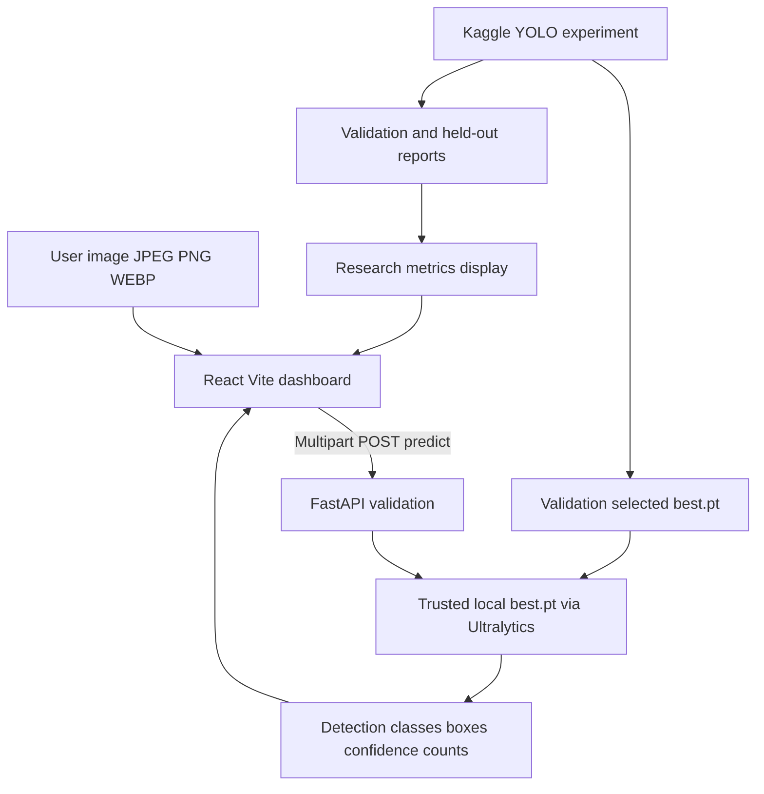

# Architecture — EggSizeGrader

**EggSizeGrader** is Day 38 of the [100 Days of Projects](https://github.com/MENSTRUE) portfolio. It detects bounding boxes and annotated classes (`large`, `medium`, `small`) in egg photographs using a validation-selected YOLOv8n checkpoint. The project joins a leakage-aware Kaggle experiment, local FastAPI inference, and a React/TypeScript analysis interface. **It does not measure physical diameter or weight and is not an official commercial grading system.**

## 9. Features and maturity

Implemented: image upload (JPEG/PNG/WEBP, ≤10 MiB), confidence and IoU settings, class-specific boxes, counts, annotated PNG and CSV download, readiness indicator, research-insights panel. Export/live inference require a locally available model. Authentication, audit trails, persistence and multi-user scheduling are not implemented.

## 10. System architecture



## 23. Validation and final held-out metrics

| Metric | Validation (41 images) | Frozen held-out test (50 images) |
|---|---:|---:|
| Precision | 89.81% | 83.60% |
| Recall | 82.31% | 86.64% |
| mAP@50 | 90.99% | 91.13% |
| mAP@50–95 | 83.53% | 84.28% |
| AP@50–95 large | 77.32% | 77.01% |
| AP@50–95 medium | 89.27% | 89.84% |
| AP@50–95 small | 84.00% | 85.99% |


## 24. Per-class behavior and confusion matrix

On held-out test, **large** has the lowest AP@50–95 (77.01%); medium reaches 89.84% and small 85.99%. **No test confusion-matrix asset exists in the audited repository**; therefore, no confusion-matrix values are claimed. Object detection errors require IoU-based matching, not classification-only accuracy.

## 25. Error analysis and interpretation

The moderate relative weakness of `large` warrants qualitative review of missed boxes and class confusion. The saved test prediction grid provides visual examples, but the repository does not present a quantitative FP/FN breakdown by cause. Domain shift between cameras and lighting is not measured.

## 27. Backend capabilities

FastAPI endpoints: `GET /api/v1/health` (liveness); `GET /api/v1/ready` (attempts model load); `GET /api/v1/model` (metadata); `POST /api/v1/predict` (real detection). Allowed MIME types JPEG/PNG/WEBP, maximum 10 MiB, 25 megapixels. Incompatible file gives 415, invalid image 422, oversize 413, unavailable checkpoint 503.

## 29. Repository layout

Preserves existing root: `README.md`, `AGENTS.md`, `LICENSE`, `.env.example`, `.gitignore`; `notebooks/`, `models/`, `reports/`, `assets/{plots,examples,screenshots,diagrams}`, `backend/`, `frontend/`, `docs/`, `scripts/`. See [architecture](architecture.md). Raw datasets and `.pt` weights are deliberately excluded.

## 30. System requirements

Windows PowerShell example uses Python 3.11, pip, Node.js/npm and local CPU inference; GPU not required for the current backend. Training used Kaggle T4. Downloading dependencies may be heavy on slow networks.

## 31. Setup and installation

```powershell
cd "D:\porto\100 day\day 38"
python -m venv .venv
.\.venv\Scripts\Activate.ps1
python -m pip install -r backend\requirements.txt
python -m pytest backend\tests -v
python -m uvicorn backend.app.main:app --reload --port 8000
```
Open a **second** PowerShell terminal:
```powershell
cd "D:\porto\100 day\day 38\frontend"
npm install
npm run build
npm run dev
```
API `http://127.0.0.1:8000/docs`; UI `http://127.0.0.1:5173`. Local checkpoint `models/best.pt` must be supplied from the saved Kaggle artifact because `.gitignore` excludes `*.pt`.

## Source material and verification

All numeric results above originate from the checked-in experiment reports, not from new computation in this documentation update. The original study includes a single architecture; the local image screenshot is a demonstration, not evidence of physical-size correctness.

[Repository README](../../README.md) · [reports](../../reports/README.md) · [notebook](../../notebooks/eggsizegrader.ipynb)
