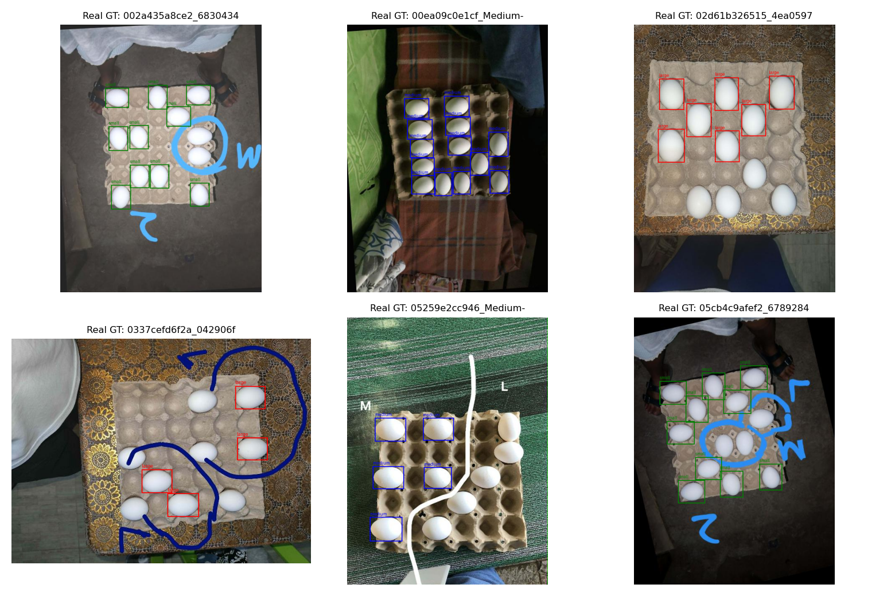

# Evaluation — EggSizeGrader

**EggSizeGrader** is Day 38 of the [100 Days of Projects](https://github.com/MENSTRUE) portfolio. It detects bounding boxes and annotated classes (`large`, `medium`, `small`) in egg photographs using a validation-selected YOLOv8n checkpoint. The project joins a leakage-aware Kaggle experiment, local FastAPI inference, and a React/TypeScript analysis interface. **It does not measure physical diameter or weight and is not an official commercial grading system.**

## 16. Cleaning and preprocessing

Corrupt/unreadable images, missing labels, invalid class IDs or out-of-range boxes were designed to trigger a fail-fast stop. Source filename `.rf.*` suffixes were normalized to derive conservative source identities; SHA-256 hashes were also computed. Dataset repackaging copies verified image/label pairs into Kaggle working directories.

## 17. Split and distribution

| Split | Images | Large boxes | Medium boxes | Small boxes |
|---|---:|---:|---:|---:|
| Train | 227 | 524 | 689 | 561 |
| Validation | 41 | 146 | 64 | 101 |
| Held-out test | 50 | 136 | 131 | 112 |
| **Total** | **318** | **806** | **884** | **774** |

## 21. Training setup

Seed=42, pretrained `yolov8n.pt`, 60 epochs configured, patience=15, image size=640, batch=16, optimizer=`auto`, GPU device index 0 on Kaggle. Selection follows Ultralytics validation fitness. Exact effective completed epochs should be checked against the captured training log if asserted.

## 22. Champion selection

`best.pt` was chosen by the training framework from **validation**, not test. `reports/model_selection.json` lists one architecture and explicitly records `test_used_for_selection: false`. Any future threshold tuning should use validation, not the frozen test.

## 23. Validation and final held-out metrics

| Metric | Validation (41 images) | Frozen held-out test (50 images) |
|---|---:|---:|
| Precision | 89.81% | 83.60% |
| Recall | 82.31% | 86.64% |
| mAP@50 | 90.99% | 91.13% |
| mAP@50–95 | 83.53% | 84.28% |
| AP@50–95 large | 77.32% | 77.01% |
| AP@50–95 medium | 89.27% | 89.84% |
| AP@50–95 small | 84.00% | 85.99% |

## 24. Per-class behavior and confusion matrix

On held-out test, **large** has the lowest AP@50–95 (77.01%); medium reaches 89.84% and small 85.99%. **No test confusion-matrix asset exists in the audited repository**; therefore, no confusion-matrix values are claimed. Object detection errors require IoU-based matching, not classification-only accuracy.

## 25. Error analysis and interpretation

The moderate relative weakness of `large` warrants qualitative review of missed boxes and class confusion. The saved test prediction grid provides visual examples, but the repository does not present a quantitative FP/FN breakdown by cause. Domain shift between cameras and lighting is not measured.

## 26. Model artifacts and contracts

Model loader checks file existence and expects exact ordered classes `large`, `medium`, `small`. `POST /api/v1/predict` returns model, original image width/height, list of detections with class id/label/confidence/XYXY pixel coordinates, class counts, total, latency, and research warning. File is decoded with Pillow and EXIF orientation applied.

## 27. Backend capabilities

FastAPI endpoints: `GET /api/v1/health` (liveness); `GET /api/v1/ready` (attempts model load); `GET /api/v1/model` (metadata); `POST /api/v1/predict` (real detection). Allowed MIME types JPEG/PNG/WEBP, maximum 10 MiB, 25 megapixels. Incompatible file gives 415, invalid image 422, oversize 413, unavailable checkpoint 503.

## 35. Visual evidence

*Ground-truth YOLO boxes from the training examples; not model predictions.*

*Recorded split/class distribution and boxes per image.*

*Saved prediction visualization from the experiment; the grid is qualitative rather than a statistical accuracy measurement.*

*Local browser screenshot: 13 detected objects, all displayed as `medium`, around 2,869 ms inference on that particular run. A successful inference demonstration, not an independent ground-truth correctness check.*

## 36. Deployment readiness

**Research-local only.** Vite dev proxy, unrestricted local upload endpoint and CPU performance are not deployment certification. Require auth, rate limits, HTTPS, file and decompression limits, privacy review, packaging of trusted weights, logging/monitoring and a production service configuration.

## Source material and verification

All numeric results above originate from the checked-in experiment reports, not from new computation in this documentation update. The original study includes a single architecture; the local image screenshot is a demonstration, not evidence of physical-size correctness.

[Repository README](../../README.md) · [reports](../../reports/README.md) · [notebook](../../notebooks/eggsizegrader.ipynb)
