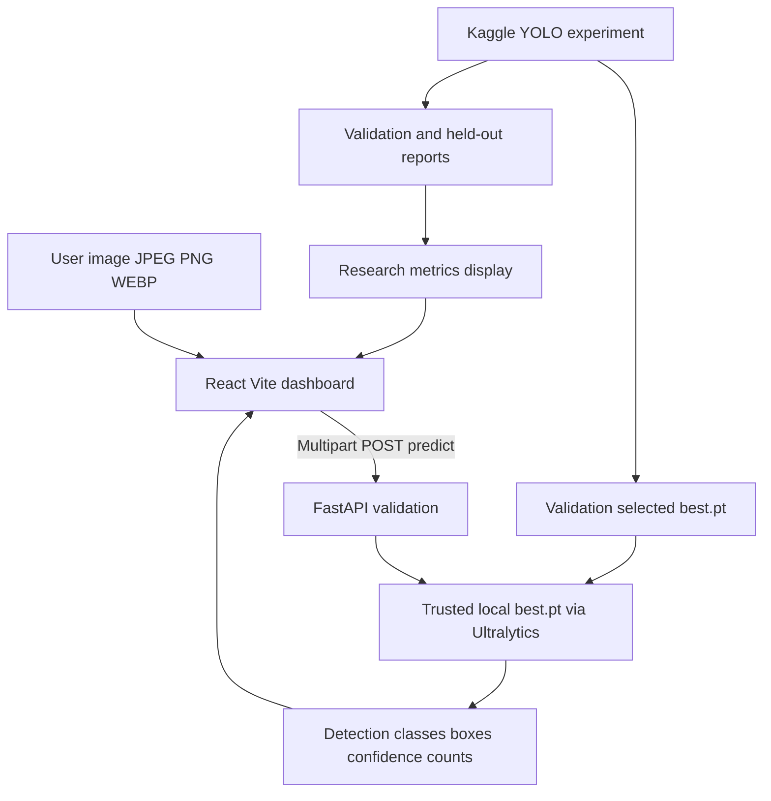

# Methodology — EggSizeGrader

**EggSizeGrader** is Day 38 of the [100 Days of Projects](https://github.com/MENSTRUE) portfolio. It detects bounding boxes and annotated classes (`large`, `medium`, `small`) in egg photographs using a validation-selected YOLOv8n checkpoint. The project joins a leakage-aware Kaggle experiment, local FastAPI inference, and a React/TypeScript analysis interface. **It does not measure physical diameter or weight and is not an official commercial grading system.**

## 4. Target users and use cases

Students, researchers and developers can test YOLO detection, evaluate leakage controls, compare per-class AP and inspect local inference. Commercial sorting decisions are out of scope.

## 10. System architecture

## 13. Dataset license and attribution

The dataset YAML **declares** `CC BY 4.0`; upstream permission must be checked separately. Attribution to the named Roboflow project is retained. `LICENSE` in this repo expressly says **license not yet selected**, so no blanket permissive source-code license is claimed. Ultralytics, weights, and any third-party dependencies require their own license review for distribution.

## 14. Discovery and data audit

318 image/label pairs were audited; original folders: train 262, valid 38, test 18. YOLO labels were checked for class indices and normalized box coordinates. No backgrounds were recorded. See `reports/source_inventory.csv` and `reports/annotation_issues.csv`.

## 15. Classes and annotation definition

Class index 0=`large`, 1=`medium`, 2=`small`. Each YOLO annotation row holds `class_id cx cy width height`, normalized relative to image dimensions. These names are human-provided image labels, not instrument measurements.

## 16. Cleaning and preprocessing

Corrupt/unreadable images, missing labels, invalid class IDs or out-of-range boxes were designed to trigger a fail-fast stop. Source filename `.rf.*` suffixes were normalized to derive conservative source identities; SHA-256 hashes were also computed. Dataset repackaging copies verified image/label pairs into Kaggle working directories.

## 17. Split and distribution

| Split | Images | Large boxes | Medium boxes | Small boxes |
|---|---:|---:|---:|---:|
| Train | 227 | 524 | 689 | 561 |
| Validation | 41 | 146 | 64 | 101 |
| Held-out test | 50 | 136 | 131 | 112 |
| **Total** | **318** | **806** | **884** | **774** |

## 18. Duplicate and leakage assessment

Original split inspection found **12 source keys crossing original splits** and **0 identical SHA-256 hashes crossing splits**. A union of source-name and byte-hash identities produced **153 conservative groups**. GroupShuffleSplit (seed 42) placed each group entirely within one new split. This does not exclude visually similar images having different filenames/hashes.

## 19. Model architecture

Ultralytics **YOLOv8n** object detector (reported 3,011,433 parameters with detection head adapted from 80 to 3 classes). The saved PyTorch checkpoint is `models/best.pt` locally; `.pt` is Git-ignored. Inference is forced to CPU in `backend/app/inference/yolo.py`.

## 20. Experiment and baseline

One pretrained architecture was trained; there is no cross-architecture controlled comparison. An always-no-boxes sanity baseline yields zero recall on annotated samples, but **was not given a fabricated mAP**. Design is single-model research proof of concept.

## 21. Training setup

Seed=42, pretrained `yolov8n.pt`, 60 epochs configured, patience=15, image size=640, batch=16, optimizer=`auto`, GPU device index 0 on Kaggle. Selection follows Ultralytics validation fitness. Exact effective completed epochs should be checked against the captured training log if asserted.

## Source material and verification

All numeric results above originate from the checked-in experiment reports, not from new computation in this documentation update. The original study includes a single architecture; the local image screenshot is a demonstration, not evidence of physical-size correctness.

[Repository README](../../README.md) · [reports](../../reports/README.md) · [notebook](../../notebooks/eggsizegrader.ipynb)
