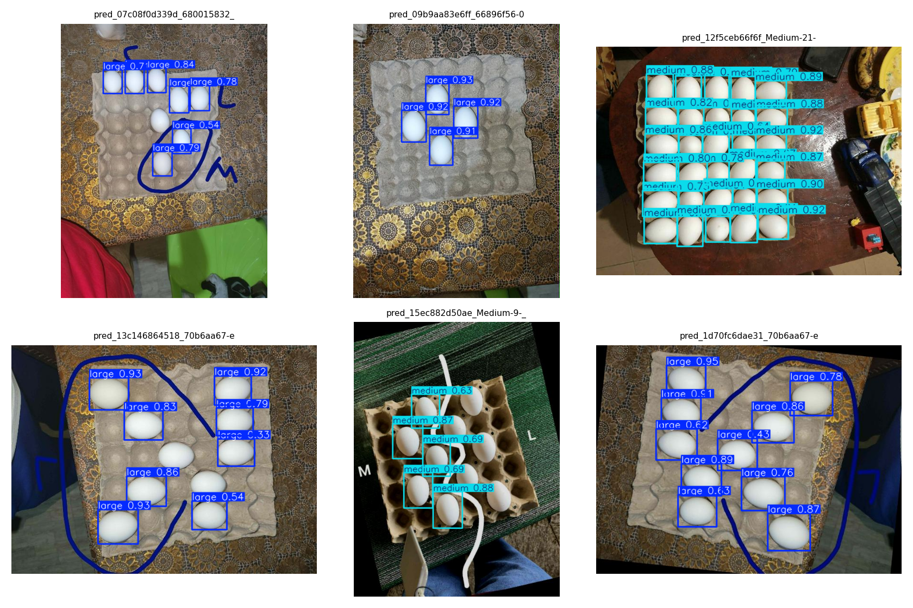

# Troubleshooting — EggSizeGrader

**EggSizeGrader** is Day 38 of the [100 Days of Projects](https://github.com/MENSTRUE) portfolio. It detects bounding boxes and annotated classes (`large`, `medium`, `small`) in egg photographs using a validation-selected YOLOv8n checkpoint. The project joins a leakage-aware Kaggle experiment, local FastAPI inference, and a React/TypeScript analysis interface. **It does not measure physical diameter or weight and is not an official commercial grading system.**

## 24. Per-class behavior and confusion matrix

On held-out test, **large** has the lowest AP@50–95 (77.01%); medium reaches 89.84% and small 85.99%. **No test confusion-matrix asset exists in the audited repository**; therefore, no confusion-matrix values are claimed. Object detection errors require IoU-based matching, not classification-only accuracy.

## 29. Repository layout

Preserves existing root: `README.md`, `AGENTS.md`, `LICENSE`, `.env.example`, `.gitignore`; `notebooks/`, `models/`, `reports/`, `assets/{plots,examples,screenshots,diagrams}`, `backend/`, `frontend/`, `docs/`, `scripts/`. See [architecture](architecture.md). Raw datasets and `.pt` weights are deliberately excluded.

## 30. System requirements

Windows PowerShell example uses Python 3.11, pip, Node.js/npm and local CPU inference; GPU not required for the current backend. Training used Kaggle T4. Downloading dependencies may be heavy on slow networks.

## 31. Setup and installation

```powershell
cd "D:\porto\100 day\day 38"
python -m venv .venv
.\.venv\Scripts\Activate.ps1
python -m pip install -r backend\requirements.txt
python -m pytest backend\tests -v
python -m uvicorn backend.app.main:app --reload --port 8000
```
Open a **second** PowerShell terminal:
```powershell
cd "D:\porto\100 day\day 38\frontend"
npm install
npm run build
npm run dev
```
API `http://127.0.0.1:8000/docs`; UI `http://127.0.0.1:5173`. Local checkpoint `models/best.pt` must be supplied from the saved Kaggle artifact because `.gitignore` excludes `*.pt`.

## 32. Run and usage examples

Open API docs at `http://127.0.0.1:8000/docs`. Check `/api/v1/ready`: `ready=true` means a model was loaded and classes validated. Browse/select a test image, choose thresholds, click Generate detections, inspect boxes and counts, then download annotated PNG or CSV.

## 35. Visual evidence


*Ground-truth YOLO boxes from the training examples; not model predictions.*


*Recorded split/class distribution and boxes per image.*


*Saved prediction visualization from the experiment; the grid is qualitative rather than a statistical accuracy measurement.*


*Local browser screenshot: 13 detected objects, all displayed as `medium`, around 2,869 ms inference on that particular run. A successful inference demonstration, not an independent ground-truth correctness check.*

## 36. Deployment readiness

**Research-local only.** Vite dev proxy, unrestricted local upload endpoint and CPU performance are not deployment certification. Require auth, rate limits, HTTPS, file and decompression limits, privacy review, packaging of trusted weights, logging/monitoring and a production service configuration.

## 38. Known limitations

Small image dataset (318), possible near-duplicate leakage not detected by hash/name, source labels without measurement calibration, single model architecture, no external-camera benchmark, no formal error taxonomy, CPU-only inference, no server deployment, no automatic browser E2E.

## 39. Claim boundaries

A detected `medium` is a **dataset-label prediction**, not proof of a medium egg by mass, diameter or official standard. Confidence is **not calibrated probability of physical correctness**. Held-out score belongs to the internal grouped dataset and cannot generalize automatically to new egg farms.

## Source material and verification

All numeric results above originate from the checked-in experiment reports, not from new computation in this documentation update. The original study includes a single architecture; the local image screenshot is a demonstration, not evidence of physical-size correctness.

[Repository README](../../README.md) · [reports](../../reports/README.md) · [notebook](../../notebooks/eggsizegrader.ipynb)
