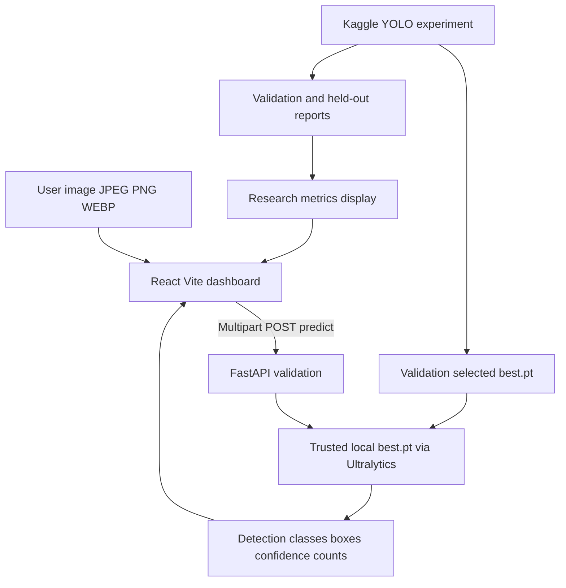

# Architecture — EggSizeGrader

**EggSizeGrader** merupakan proyek hari ke-38 dari portofolio [100 Days of Projects](https://github.com/MENSTRUE). Sistem mendeteksi kotak objek dan kategori anotasi (`large`, `medium`, `small`) pada foto telur menggunakan checkpoint YOLOv8n yang dipilih melalui validasi. Proyek memadukan eksperimen Kaggle dengan audit kebocoran data, inferensi FastAPI lokal, serta antarmuka React/TypeScript. **Sistem tidak mengukur diameter atau berat fisik dan bukan sistem grading komersial resmi.**

## 9. Features and maturity

Terimplementasi: unggah JPEG/PNG/WEBP (≤10 MiB), pengaturan confidence/IoU, kotak per kelas, jumlah, ekspor PNG dan CSV, indikator kesiapan, panel hasil penelitian. Inferensi memerlukan model lokal. Autentikasi, audit trail, persistensi, dan penjadwalan multiuser belum diterapkan.

## 10. System architecture



## 23. Validation and final held-out metrics

| Metric | Validation (41 images) | Frozen held-out test (50 images) |
|---|---:|---:|
| Precision | 89.81% | 83.60% |
| Recall | 82.31% | 86.64% |
| mAP@50 | 90.99% | 91.13% |
| mAP@50–95 | 83.53% | 84.28% |
| AP@50–95 large | 77.32% | 77.01% |
| AP@50–95 medium | 89.27% | 89.84% |
| AP@50–95 small | 84.00% | 85.99% |


## 24. Per-class behavior and confusion matrix

Pada held-out test, kelas **large** memiliki AP@50–95 terendah (77,01%); medium 89,84%, small 85,99%. **Aset confusion matrix test tidak ditemukan dalam audit repository** sehingga nilainya tidak diklaim. Error deteksi perlu pencocokan berbasis IoU, bukan akurasi klasifikasi saja.

## 25. Error analysis and interpretation

Kelemahan relatif kelas `large` perlu telaah false negative dan kekeliruan kelas. Grid prediksi test menyediakan contoh visual, tetapi repository belum menyediakan perincian FP/FN kuantitatif per penyebab. Pergeseran domain antar kamera/cahaya belum diukur.

## 27. Backend capabilities

Endpoint FastAPI: `GET /api/v1/health` (liveness); `GET /api/v1/ready` (mencoba load model); `GET /api/v1/model` (metadata); `POST /api/v1/predict` (deteksi asli). MIME JPEG/PNG/WEBP, maksimal 10 MiB dan 25 megapiksel. Tipe salah 415, gambar invalid 422, terlalu besar 413, checkpoint tidak tersedia 503.

## 29. Repository layout

Mempertahankan root: `README.md`, `AGENTS.md`, `LICENSE`, `.env.example`, `.gitignore`; `notebooks/`, `models/`, `reports/`, `assets/{plots,examples,screenshots,diagrams}`, `backend/`, `frontend/`, `docs/`, `scripts/`. Lihat [arsitektur](architecture.md). Dataset mentah dan bobot `.pt` tidak dimasukkan Git.

## 30. System requirements

Contoh Windows PowerShell menggunakan Python 3.11, pip, Node.js/npm dan inferensi CPU lokal; backend saat ini tidak membutuhkan GPU. Training memakai GPU T4 Kaggle. Unduhan dependency dapat berat pada koneksi lambat.

## 31. Setup and installation

```powershell
cd "D:\porto\100 day\day 38"
python -m venv .venv
.\.venv\Scripts\Activate.ps1
python -m pip install -r backend\requirements.txt
python -m pytest backend\tests -v
python -m uvicorn backend.app.main:app --reload --port 8000
```
Buka terminal PowerShell **kedua**:
```powershell
cd "D:\porto\100 day\day 38\frontend"
npm install
npm run build
npm run dev
```
API `http://127.0.0.1:8000/docs`; UI `http://127.0.0.1:5173`. Checkpoint lokal `models/best.pt` harus disalin dari artefak Kaggle karena `.gitignore` mengabaikan `*.pt`.

## Sumber dan verifikasi

Semua hasil numerik di atas berasal dari laporan eksperimen dalam repository, bukan hasil hitung ulang pada perubahan dokumentasi ini. Studi hanya menggunakan satu arsitektur; screenshot gambar lokal merupakan demonstrasi, bukan bukti kebenaran ukuran fisik.

[README utama](../../README.md) · [reports](../../reports/README.md) · [notebook](../../notebooks/eggsizegrader.ipynb)
