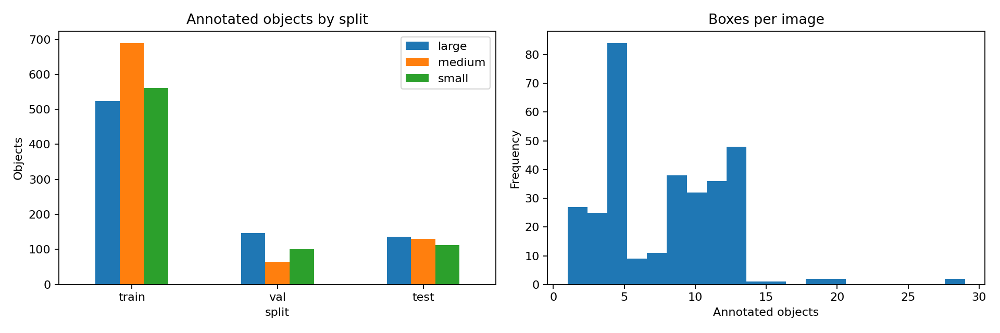

# Limitations — EggSizeGrader

**EggSizeGrader** merupakan proyek hari ke-38 dari portofolio [100 Days of Projects](https://github.com/MENSTRUE). Sistem mendeteksi kotak objek dan kategori anotasi (`large`, `medium`, `small`) pada foto telur menggunakan checkpoint YOLOv8n yang dipilih melalui validasi. Proyek memadukan eksperimen Kaggle dengan audit kebocoran data, inferensi FastAPI lokal, serta antarmuka React/TypeScript. **Sistem tidak mengukur diameter atau berat fisik dan bukan sistem grading komersial resmi.**

## 5. Objectives and research questions

Apakah YOLOv8n tiga kelas dapat mengenali objek telur pada held-out test berbasis grup? Seberapa berisiko overlap identitas sumber Roboflow pada split asli? Apakah checkpoint asli dapat melayani unggahan lokal?

## 8. Implementation status

**Diverifikasi dari repository:** sumber kode, 4 tes kontrak API, metrik JSON, screenshot, contoh gambar. **Dilaporkan dari lokal:** pytest 4/4 lulus, dependency terpasang, screenshot inferensi. **Belum diverifikasi:** deployment publik, benchmark banyak perangkat, keandalan produksi.

## 13. Dataset license and attribution

YAML dataset **menyatakan** `CC BY 4.0`, tetapi izin sumber perlu diverifikasi terpisah. Atribusi proyek Roboflow dipertahankan. File `LICENSE` repository justru menyatakan **lisensi belum dipilih**, sehingga tidak ada klaim lisensi kode permisif. Lisensi Ultralytics, bobot, dan dependency perlu diperiksa sebelum distribusi.

## 17. Split and distribution

| Split | Images | Large boxes | Medium boxes | Small boxes |
|---|---:|---:|---:|---:|
| Train | 227 | 524 | 689 | 561 |
| Validation | 41 | 146 | 64 | 101 |
| Held-out test | 50 | 136 | 131 | 112 |
| **Total** | **318** | **806** | **884** | **774** |

## 25. Error analysis and interpretation

Kelemahan relatif kelas `large` perlu telaah false negative dan kekeliruan kelas. Grid prediksi test menyediakan contoh visual, tetapi repository belum menyediakan perincian FP/FN kuantitatif per penyebab. Pergeseran domain antar kamera/cahaya belum diukur.

## 32. Run and usage examples

Buka dokumentasi API `http://127.0.0.1:8000/docs`. Cek `/api/v1/ready`: `ready=true` berarti model berhasil dimuat dan kelas diverifikasi. Pilih gambar uji, atur threshold, klik Generate detections, tinjau kotak/hitungan lalu unduh PNG anotasi atau CSV.

## 33. End-to-end testing

Laporan pengujian lokal: `4 passed, 1 warning` di Windows/Python 3.11; tes mencakup health, kontrak model, penolakan MIME, gambar invalid. Screenshot menunjukkan **satu inferensi lokal nyata**: 13 kotak medium, sekitar 2.869 ms. Hal ini tidak membuktikan semua kotak benar. Belum ada suite E2E browser otomatis.

## 34. Reproducibility and lineage

Notebook `notebooks/eggsizegrader.ipynb` mencatat audit, seed split 42, konfigurasi 60 epoch, evaluasi dan pembuatan ZIP artefak. Folder `reports/` menyimpan keanggotaan split dan inventaris SHA-256. Runtime Kaggle menggunakan Python 3.13.16 dan Ultralytics 8.4.213; lokal memakai Python 3.11.9 dengan versi paket lebih baru. Rentang dependency bukan environment lock identik.

## 35. Visual evidence

*Kotak ground truth YOLO pada contoh pelatihan, bukan prediksi model.*

*Distribusi split/kelas serta kotak per gambar berdasarkan artefak.*

*Visualisasi prediksi tersimpan; bersifat kualitatif, bukan ukuran akurasi statistik.*

*Screenshot browser lokal: 13 objek terdeteksi, semuanya tampil sebagai `medium`, dengan sekitar 2.869 ms inferensi pada satu eksekusi. Bukti aplikasi berjalan, bukan pengujian kebenaran anotasi independen.*

## 36. Deployment readiness

**Hanya riset lokal.** Proxy Vite dev, endpoint unggah tanpa autentikasi, dan performa CPU bukan bukti kesiapan deployment. Produksi memerlukan autentikasi, rate limit, HTTPS, pembatasan dekompresi, tinjauan privasi, distribusi bobot tepercaya, logging/monitoring dan konfigurasi layanan.

## 37. Security and privacy

API memeriksa tipe konten, jumlah byte dan decode Pillow; gambar diolah dalam memori. Jangan memuat bobot `.pt` sembarangan (risiko pickle PyTorch). Jangan menganggap browser/log jaringan tidak mencatat data. Tidak tersedia autentikasi dan kontrol akses pengguna.

## Sumber dan verifikasi

Semua hasil numerik di atas berasal dari laporan eksperimen dalam repository, bukan hasil hitung ulang pada perubahan dokumentasi ini. Studi hanya menggunakan satu arsitektur; screenshot gambar lokal merupakan demonstrasi, bukan bukti kebenaran ukuran fisik.

[README utama](../../README.md) · [reports](../../reports/README.md) · [notebook](../../notebooks/eggsizegrader.ipynb)
