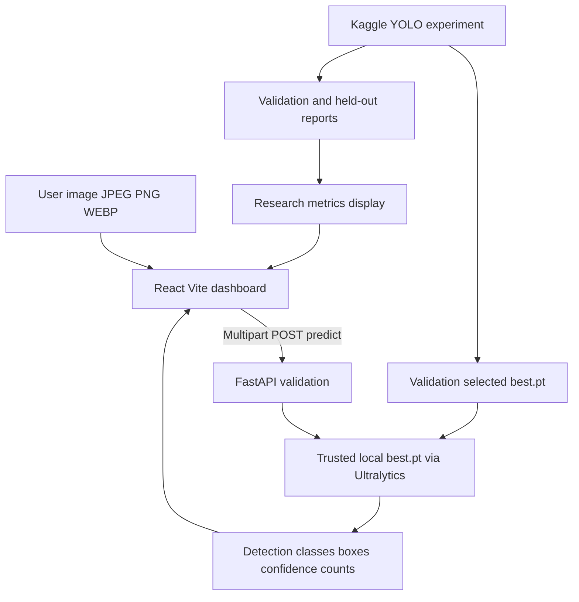

# Methodology — EggSizeGrader

**EggSizeGrader** merupakan proyek hari ke-38 dari portofolio [100 Days of Projects](https://github.com/MENSTRUE). Sistem mendeteksi kotak objek dan kategori anotasi (`large`, `medium`, `small`) pada foto telur menggunakan checkpoint YOLOv8n yang dipilih melalui validasi. Proyek memadukan eksperimen Kaggle dengan audit kebocoran data, inferensi FastAPI lokal, serta antarmuka React/TypeScript. **Sistem tidak mengukur diameter atau berat fisik dan bukan sistem grading komersial resmi.**

## 4. Target users and use cases

Mahasiswa, peneliti, dan pengembang dapat menguji deteksi YOLO, audit leakage, membandingkan AP per kelas, serta memeriksa inferensi lokal. Keputusan sortir komersial di luar cakupan.

## 10. System architecture

## 13. Dataset license and attribution

YAML dataset **menyatakan** `CC BY 4.0`, tetapi izin sumber perlu diverifikasi terpisah. Atribusi proyek Roboflow dipertahankan. File `LICENSE` repository justru menyatakan **lisensi belum dipilih**, sehingga tidak ada klaim lisensi kode permisif. Lisensi Ultralytics, bobot, dan dependency perlu diperiksa sebelum distribusi.

## 14. Discovery and data audit

318 pasangan gambar/label diaudit; split sumber train 262, valid 38, test 18. Label YOLO diperiksa untuk ID kelas dan koordinat normalisasi bounding box. Tidak tercatat contoh background. Lihat `reports/source_inventory.csv` serta `reports/annotation_issues.csv`.

## 15. Classes and annotation definition

ID kelas 0=`large`, 1=`medium`, 2=`small`. Tiap anotasi YOLO memuat `class_id cx cy width height` dalam koordinat normalisasi. Nama tersebut merupakan label gambar dari anotator, bukan hasil instrumen ukur.

## 16. Cleaning and preprocessing

Gambar rusak, label hilang, ID kelas tak valid, atau bounding box di luar rentang harus menghentikan proses. Sufiks nama `.rf.*` dinormalisasi menjadi identitas sumber konservatif; hash SHA-256 dihitung. Penyiapan data menyalin pasangan gambar/label tervalidasi ke direktori kerja Kaggle.

## 17. Split and distribution

| Split | Images | Large boxes | Medium boxes | Small boxes |
|---|---:|---:|---:|---:|
| Train | 227 | 524 | 689 | 561 |
| Validation | 41 | 146 | 64 | 101 |
| Held-out test | 50 | 136 | 131 | 112 |
| **Total** | **318** | **806** | **884** | **774** |

## 18. Duplicate and leakage assessment

Audit split asli menemukan **12 source key pada lintas split** dan **0 hash SHA-256 identik lintas split**. Penggabungan identitas nama asal dan hash menghasilkan **153 grup konservatif**. GroupShuffleSplit (seed 42) menjaga seluruh anggota grup pada satu split baru. Metode ini tidak menutup kemungkinan gambar mirip yang bernama atau ber-hash berbeda.

## 19. Model architecture

Detektor objek Ultralytics **YOLOv8n** (tercatat 3.011.433 parameter; head disesuaikan dari 80 menjadi 3 kelas). Checkpoint PyTorch tersimpan lokal sebagai `models/best.pt`, sementara `.pt` diabaikan Git. Inferensi pada `backend/app/inference/yolo.py` menggunakan CPU.

## 20. Experiment and baseline

Satu arsitektur pralatih dilatih; tidak ada perbandingan terkontrol antarsitektur. Baseline selalu tanpa prediksi kotak mempunyai recall nol pada data beranotasi, namun **tidak diberi mAP buatan**. Studi ini merupakan proof-of-concept satu model.

## 21. Training setup

Seed=42, bobot awal `yolov8n.pt`, konfigurasi 60 epoch, patience=15, ukuran gambar=640, batch=16, optimizer=`auto`, GPU Kaggle indeks 0. Pemilihan mengikuti fitness validasi Ultralytics. Jumlah epoch yang benar-benar selesai harus dicek dari log pelatihan sebelum diklaim.

## Sumber dan verifikasi

Semua hasil numerik di atas berasal dari laporan eksperimen dalam repository, bukan hasil hitung ulang pada perubahan dokumentasi ini. Studi hanya menggunakan satu arsitektur; screenshot gambar lokal merupakan demonstrasi, bukan bukti kebenaran ukuran fisik.

[README utama](../../README.md) · [reports](../../reports/README.md) · [notebook](../../notebooks/eggsizegrader.ipynb)
